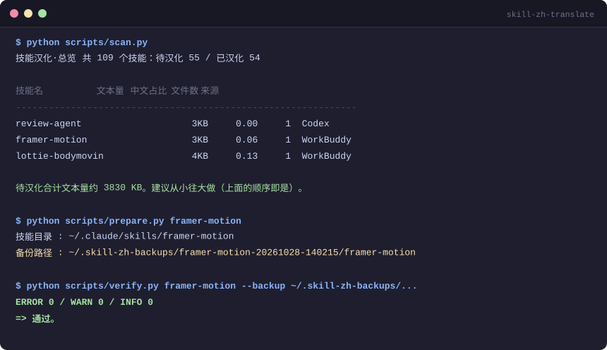

# skill-zh-translate

> 把英文 AI 技能包（Agent Skills）整体汉化为中文，**并在翻译后自动证明没有把它改坏**。

[](https://github.com/Jiao261/skill-zh-translate/actions/workflows/ci.yml)


[English summary](#english-summary) · [工作原理](#工作原理) · [校验项](#校验项它到底在防什么)

---



## 为什么需要它

Agent Skills（`SKILL.md` + `scripts/` + `references/`）正在成为 AI 编程工具的标准扩展格式，但生态里绝大多数技能包是英文写的。中文用户面对的问题不是"看不懂"，而是：

- **不敢改**。`SKILL.md` 的 frontmatter 里 `name` 一旦被"顺手翻译"，技能就调用不到了。
- **改了就坏**。正文里的 `python scripts/run.py`、`$ENV_VAR`、`<skill_dir>` 这类占位符一旦被译成中文，模型执行时直接报错。
- **坏了不知道**。翻译完看起来通顺，实际代码块少了一个反引号、链接目标被吞掉，只有真正跑起来才暴露。

直接让模型"把这份文档翻译成中文"，上面三件事都会发生。

**这个工具的做法是：把翻译拆成"备份 → 翻译 → 校验"三段，翻译交给模型，但翻译结果必须通过一套机器校验才能算完成。**

## 工作原理

```
prepare.py            模型翻译              verify.py
    │                     │                     │
清点文件 ──► 备份整包 ──► 逐文件译 ──► 与备份逐项比对 ──► 0 ERROR 才算完成
分类标注      时间戳目录    保持结构      退出码 0/1
```

三个脚本分工明确，且**只依赖 Python 标准库**，不需要 pip install 任何东西：

| 脚本 | 职责 | 退出码 |
|---|---|---|
| `prepare.py` | 定位技能 → 清点文件 → 按 `translate`/`code`/`data`/`binary` 分类 → 整包备份 → 打印翻译顺序 | 0 正常 / 1 出错 |
| `scan.py` | 扫描所有技能根目录，按中文字符占比判定待汉化，**按文本量升序**排序（先做小的，收益最快） | 0 全已汉化 / 2 有待汉化 |
| `verify.py` | 把译文与备份逐项比对，输出 `ERROR`/`WARN`/`INFO` | 0 无 ERROR / 1 有 ERROR |

`verify.py` 的退出码是刻意设计的——它能直接塞进 CI，让"翻译没搞坏技能"这件事变成可自动化的门禁。

## 快速开始

### 1. 安装

把仓库放进你所用工具的技能目录：

```bash
git clone https://github.com/Jiao261/skill-zh-translate.git

# WorkBuddy
cp -r skill-zh-translate ~/.workbuddy-ai/skills/
# Claude Code
cp -r skill-zh-translate ~/.claude/skills/
# Cursor（项目级）
cp -r skill-zh-translate .cursor/skills/
```

也可以直接把仓库路径用环境变量指过去，不必复制：

```bash
export SKILL_ZH_ROOTS="$HOME/.claude/skills"
```

### 2. 看看有多少技能等着汉化

```bash
python scripts/scan.py
```

```
技能汉化·总览   共 109 个技能：待汉化 55 / 已汉化 54
判定阈值：SKILL.md 中文字符占比 < 0.15 即视为待汉化

技能名                                 文本量    中文占比    文件数 来源
------------------------------------------------------------------------------
review-agent                        3KB    0.00      1 Codex
framer-motion                       3KB    0.06      1 WorkBuddy
lottie-bodymovin                    4KB    0.13      1 WorkBuddy
```

### 3. 汉化一个技能

```bash
# 第一步：备份 + 清点（会打印备份路径，记下来）
python scripts/prepare.py framer-motion

# 第二步：按 SKILL.md 里的工作流逐文件翻译
#         （这一步由 AI 助手完成，翻译规则见 references/translation-rules.md）

# 第三步：校验
python scripts/verify.py framer-motion --backup ~/.skill-zh-backups/framer-motion-20261028-134700/framer-motion
```

校验通过会看到：

```
ERROR 0 / WARN 0 / INFO 0
=> 通过。
```

## 支持的平台

技能根目录自动发现，存在即纳入扫描：

| 平台 | 用户级 | 项目级 |
|---|---|---|
| WorkBuddy | `~/.workbuddy-ai/skills` | `.workbuddy-ai/skills` |
| Claude Code | `~/.claude/skills` | `.claude/skills` |
| Cursor | `~/.cursor/skills` | `.cursor/skills` |
| Codex | `~/.codex/skills` | `.codex/skills` |
| Agents | `~/.agents/skills` | `.agents/skills` |

自定义路径（优先级最高）：

```bash
export SKILL_ZH_ROOTS="/path/a:/path/b"   # Windows 用分号分隔
```

## 校验项：它到底在防什么

这是整个项目的核心。`verify.py` 把译文和备份逐项比对，共 12 项检查：

| # | 检查项 | 级别 | 防的是什么 |
|---|---|---|---|
| 1 | 围栏代码块配对 | ERROR | 译文被截断，只剩一个 ``` |
| 2 | frontmatter 存在性 | ERROR | 开头 YAML 被整块删掉 |
| 3 | frontmatter `name` 未变 | ERROR | 技能名被翻译，调用链断裂 |
| 4 | frontmatter 字段未丢失 | ERROR | 顺手删了 `allowed-tools` 之类 |
| 5 | 围栏代码块内容一致 | ERROR | `run.py` 被译成 `runner.py` |
| 6 | 代码块数量一致 | ERROR | 合并/拆分了代码块 |
| 7 | 行内代码一致 | WARN | `` `--verbose` `` 被译成中文 |
| 8 | 链接目标一致 | WARN | 链接文字译了，URL 被吞 |
| 9 | URL 一致 | WARN | 裸 URL 被误改 |
| 10 | 标题层级一致 | WARN | 标题结构被打乱 |
| 11 | 中文占比达标 | WARN | 压根没翻 |
| 12 | 代码文件未被改动 | WARN | 顺手"优化"了 `scripts/*.py` |

此外还有一项 `INFO`：残留英文段落提示。它用**英文虚词密度**区分自然语言和命令行——`echo '{"x":1}' | python run.py` 这种行不会误报，真正的英文段落才会。

## 测试

```bash
pip install pytest
python -m pytest -v
```

24 个用例，全部通过子进程调用真实 CLI，覆盖：

- 正确译文 → `ERROR 0`，退出码 0
- 篡改 `name` / 代码块 / 链接 / 行内代码 / frontmatter → 精确报错，退出码 1
- 备份内容与原包逐字节一致
- `scan.py` 按文本量升序、跳过 `.git`、环境变量覆盖生效
- zip 包输入、`--no-backup`、技能名解析

CI 在 Ubuntu / macOS / Windows × Python 3.9 / 3.11 / 3.13 上跑全量矩阵，并额外检查**没有引入第三方依赖**。

## 目录结构

```
skill-zh-translate/
├── SKILL.md                    # 技能定义（给 AI 助手读的工作流）
├── references/
│   └── translation-rules.md    # 翻译规则：绝对不译清单、术语表、格式保留规则
├── scripts/
│   ├── skillpaths.py           # 跨平台技能目录适配层
│   ├── prepare.py              # 定位 + 清点 + 备份
│   ├── scan.py                 # 批量扫描 + 排序
│   └── verify.py               # 12 项校验
├── tests/                      # 24 个 pytest 用例
└── .github/workflows/ci.yml    # 三平台 × 三版本矩阵
```

## 边界

- **翻译由模型完成，脚本不翻译任何文本。** 脚本负责的是"不让模型把技能改坏"。
- 只译文本（`.md`/`.txt`/`.rst`），不碰代码、数据、二进制。
- 不新增、不删除、不合并、不改名任何文件。
- 校验是**结构级**的，不判断译文质量。译得通不通顺，仍然需要人看。

## English summary

`skill-zh-translate` localizes English Agent Skills (the `SKILL.md` + `scripts/` format used by Claude Code, Cursor, WorkBuddy, Codex and others) into Chinese, and — more importantly — **verifies that the translation didn't break the skill**.

The translation itself is done by an LLM. The scripts guarantee safety: `prepare.py` classifies files and snapshots the whole package; `verify.py` diffs the translation against that snapshot across 12 structural checks (frontmatter integrity, `name` immutability, fenced code block fidelity, inline code, link targets, heading structure, and more) and exits non-zero on any ERROR, so it drops straight into CI.

Stdlib only. No `pip install` required. 24 pytest cases, CI matrix on three OSes × three Python versions.

## License

[MIT](LICENSE)
